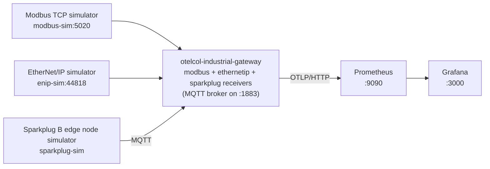

# Test environment

A small, runnable demo of the OpenTelemetry Industrial Collector: simulated
industrial devices are polled by (Modbus, EtherNet/IP) or publish to
(Sparkplug B) the `otelcol-industrial-gateway` distribution, and the metrics
land in Prometheus and a Grafana dashboard. No hardware needed, and data
shows up within a minute.

This is the first step of the shareable test environment in
[#27](https://github.com/otel-industrial/otel-industrial-resources/issues/27).



## Run it

You need Docker or Podman. The first build downloads Go modules and compiles
the collector, so it takes a few minutes.

With a compose tool, from this directory:

```sh
docker compose up --build        # or: podman compose up --build
```

With plain Podman:

```sh
bash run-podman.sh               # start
bash run-podman.sh down          # stop and remove
```

Then open:

- Grafana: <http://localhost:3000>. The "OpenTelemetry Industrial Demo"
  dashboard opens as the home page; no login needed to view it.
- Prometheus: <http://localhost:9090>

Both ports are bound to `localhost` only.

## What you should see

- **Device status:** `modbus.device.up` and `ethernetip.device.up` show UP, and
  so does the Sparkplug B device. Sparkplug B devices push data, so there is
  no `device.up` metric for them: the tile uses the receiver's `staleness`
  metric (seconds since the device last sent data) and shows UP while it is
  under 15 seconds.
- **Modbus registers and coils:** temperature, pressure, humidity, flow rate,
  pump and valve status from the Modbus simulator. The simulated pump
  switches on and off from time to time; the valve stays open.
- **EtherNet/IP tags:** temperature as a line and the pump status as ON/OFF.
- **Sparkplug B:** motor speed, motor temperature and a parts counter from a
  simulated conveyor (`demo-group` / `demo-node` / `demo-conveyor`). The
  simulator sends DDATA every 5 seconds; the receiver reports the latest
  values every 30 seconds, so these lines move in 30-second steps.
- **Scrape errors:** close to zero while the polled devices are up.

## Try it: take a device offline

Stop the Modbus simulator and watch the dashboard:

```sh
docker compose stop modbus-sim      # Podman: podman stop otel-industrial-demo-modbus-sim
docker compose start modbus-sim     # Podman: podman start otel-industrial-demo-modbus-sim
```

Within a poll or two, the Modbus device turns DOWN and scrape errors rise for
the `modbus` receiver. After you start it again, it comes back UP after the
reconnect backoff (set short in `collector.yaml` for the demo; the default
grows to 60 s). See
[Device availability alerts](../../../docs/otel-industrial-environments/security/device-availability.md)
for alert examples.

The same works for the Sparkplug B simulator. It publishes instead of being
polled, so its tile turns DOWN at the receiver's next report after it goes
silent (within about 45 seconds), and UP again at the first report after it
reconnects. Keep it stopped for a minute or more to see it:

```sh
docker compose stop sparkplug-sim   # Podman: podman stop otel-industrial-demo-sparkplug-sim
docker compose start sparkplug-sim  # Podman: podman start otel-industrial-demo-sparkplug-sim
```

## Files

| File | What it does |
|---|---|
| `Dockerfile` | Builds `otelcol-industrial-gateway` from this checkout (`make LOCAL=1`) and the three simulators |
| `sparkplug-simulator/main.go` | Sparkplug B edge node simulator (built in the Dockerfile; no `go.mod` in this repo) |
| `compose.yaml` | Simulators, gateway, Prometheus and Grafana |
| `run-podman.sh` | The same setup with plain Podman |
| `collector.yaml` | Receivers, processors and the OTLP export to Prometheus |
| `prometheus.yaml` | OTLP ingestion settings: promotes resource attributes to labels, accepts slightly late points |
| `grafana/` | Data source, dashboard provider and the dashboard |

## Notes and limitations

- The gateway image is built from your checkout, so the demo reflects your
  branch, not a release.
- Metric names in Prometheus follow its OTLP translation, for example
  `modbus.device.up` becomes `modbus_device_up`, with a unit suffix in some
  setups. The dashboard queries match both forms.
- This version covers Modbus, EtherNet/IP and Sparkplug B metrics. OPC UA
  logs and Loki are planned follow-ups
  ([#53](https://github.com/otel-industrial/otel-industrial-resources/issues/53)).
- The Sparkplug B receiver runs the MQTT broker itself. Port 1883 is only
  reachable inside the demo network. At startup it logs one harmless
  `unexpected topic: STATE/demo-gateway` error for its own status message
  ([#39](https://github.com/otel-industrial/otel-industrial-resources/issues/39)).
- For local testing only. Don't point it at production equipment without
  reading the safety notes in
  [#27](https://github.com/otel-industrial/otel-industrial-resources/issues/27).
