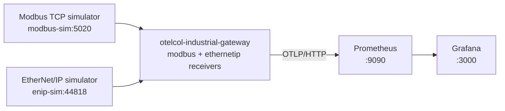

# Test environment

A small, runnable demo of the OpenTelemetry Industrial Collector: simulated
industrial devices are polled by the `otelcol-industrial-gateway`
distribution, and the metrics land in Prometheus and a Grafana dashboard. No
hardware needed, and data shows up within a minute.

This is the first step of the shareable test environment in
[#27](https://github.com/otel-industrial/otel-industrial-resources/issues/27).



## Run it

You need Docker or Podman. The first build downloads Go modules and compiles
the collector, so it takes a few minutes.

With a compose tool, from this directory:

```sh
docker compose up --build        # or: podman compose up --build
```

With plain Podman:

```sh
bash run-podman.sh               # start
bash run-podman.sh down          # stop and remove
```

Then open:

- Grafana: <http://localhost:3000>. The "OpenTelemetry Industrial Demo"
  dashboard opens as the home page; no login needed to view it.
- Prometheus: <http://localhost:9090>

Both ports are bound to `localhost` only.

## What you should see

- **Device status:** `modbus.device.up` and `ethernetip.device.up` show UP.
- **Modbus registers and coils:** temperature, pressure, humidity, flow rate,
  pump and valve status from the Modbus simulator. The simulated pump
  switches on and off from time to time; the valve stays open.
- **EtherNet/IP tags:** temperature as a line and the pump status as ON/OFF.
- **Scrape errors:** close to zero while both devices are up.

## Try it: take a device offline

Stop the Modbus simulator and watch the dashboard:

```sh
docker compose stop modbus-sim      # Podman: podman stop otel-industrial-demo-modbus-sim
docker compose start modbus-sim     # Podman: podman start otel-industrial-demo-modbus-sim
```

Within a poll or two, the Modbus device turns DOWN and scrape errors rise for
the `modbus` receiver. After you start it again, it comes back UP after the
reconnect backoff (set short in `collector.yaml` for the demo; the default
grows to 60 s). See
[Device availability alerts](../../../docs/otel-industrial-environments/security/device-availability.md)
for alert examples.

## Files

| File | What it does |
|---|---|
| `Dockerfile` | Builds `otelcol-industrial-gateway` from this checkout (`make LOCAL=1`) and both simulators |
| `compose.yaml` | Simulators, gateway, Prometheus and Grafana |
| `run-podman.sh` | The same setup with plain Podman |
| `collector.yaml` | Receivers, processors and the OTLP export to Prometheus |
| `prometheus.yaml` | OTLP ingestion settings: promotes resource attributes to labels, accepts slightly late points |
| `grafana/` | Data source, dashboard provider and the dashboard |

## Notes and limitations

- The gateway image is built from your checkout, so the demo reflects your
  branch, not a release.
- Metric names in Prometheus follow its OTLP translation, for example
  `modbus.device.up` becomes `modbus_device_up`, with a unit suffix in some
  setups. The dashboard queries match both forms.
- This first version covers Modbus and EtherNet/IP metrics. OPC UA logs,
  Sparkplug B and Loki are planned follow-ups
  ([#53](https://github.com/otel-industrial/otel-industrial-resources/issues/53)).
- For local testing only. Don't point it at production equipment without
  reading the safety notes in
  [#27](https://github.com/otel-industrial/otel-industrial-resources/issues/27).
